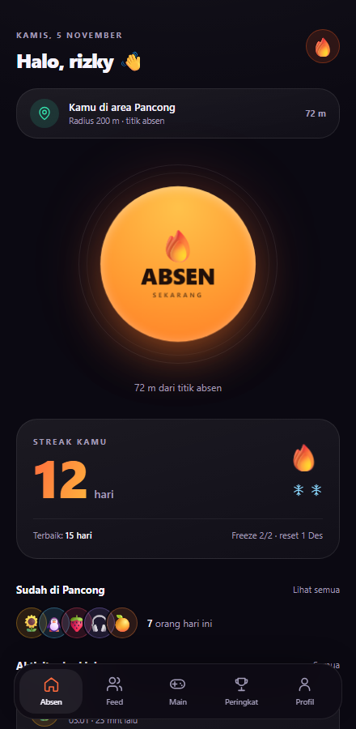
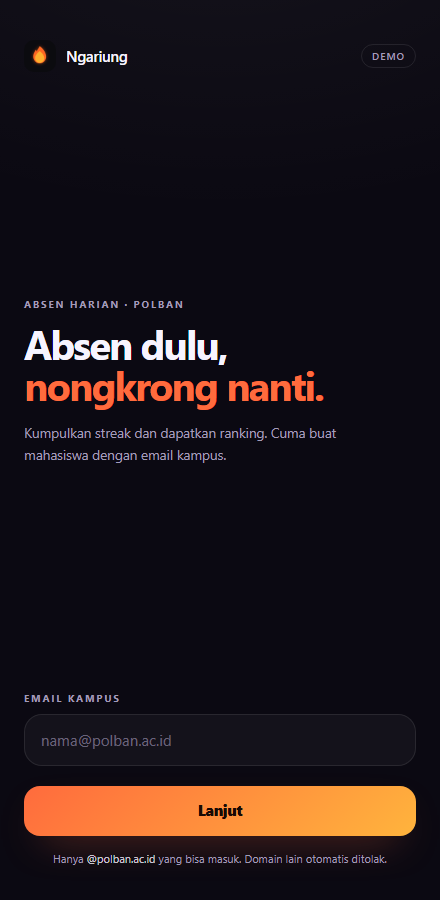
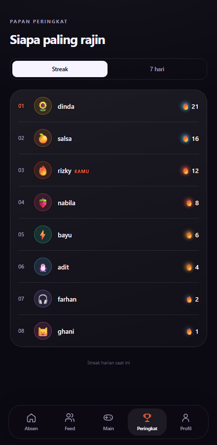
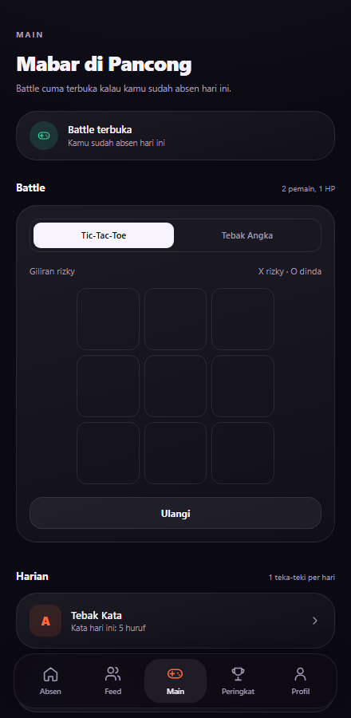
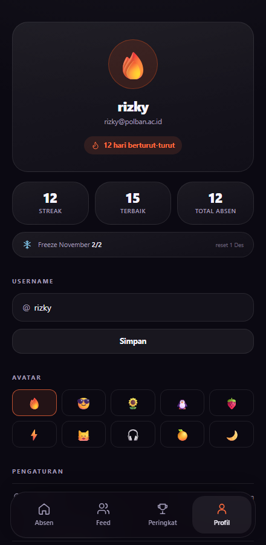

# Ngariung 🔥

**Absen dulu, baru nongkrong.**

Ngariung adalah aplikasi absen harian buat mahasiswa Politeknik Negeri Bandung. Bukan absensi kuliah — ini pencatat siapa yang sudah nongkrong di **Pancong** hari ini. Absen cuma bisa dilakukan kalau kamu benar-benar ada di sana, dalam radius **200 meter**. Setiap absen menambah streak, dan teman-temanmu langsung dapat kabar.



---

## Kenapa pakai Ngariung

- **Absennya jujur.** Tombol absen cuma hidup kalau GPS-mu menunjukkan kamu ada di area Pancong. Nggak bisa diabsen dari rumah.
- **Ada rekor yang bikin nagih.** Streak harian, rekor terbaik, dan papan peringkat bikin datang tiap hari jadi punya alasan.
- **Teman langsung tahu.** Begitu kamu absen, semua teman yang belum absen dapat notifikasi: *"kamu sudah absen hari ini, ayo segera menuju Pancong skrg!"*
- **Khusus email kampus.** Cuma bisa masuk pakai email kampus `@ikamasu.ac.id`, jadi isinya benar-benar lingkaranmu.

## Siapa yang bisa pakai

Semua mahasiswa yang punya email aktif **@ikamasu.ac.id**. Email lain (Gmail, Yahoo, dsb.) akan ditolak saat mendaftar.

---

## Fitur

| Fitur | Penjelasan |
|---|---|
| Absen lokasi | Tombol aktif hanya dalam radius 200 m dari titik Pancong |
| Streak harian | Hitungan hari berturut-turut, lengkap dengan rekor terbaik |
| Streak freeze | 2 jatah penyelamat per bulan, reset tanggal 1 |
| Notifikasi | Teman dapat kabar tiap kamu absen |
| Feed hari ini | Daftar siapa saja yang sudah absen hari ini |
| Papan peringkat | Urutan streak dan total absen 7 hari terakhir |
| Battle minigame | Tic-Tac-Toe & Tebak Angka, terbuka setelah absen |
| Game harian | Tebak Kata & Teka-teki, satu soal per hari |
| Peringkat game | Rank battle dan rank harian terpisah |
| Username | Bisa diganti kapan saja |
| Avatar | Pilih emoji atau unggah fotomu sendiri |

---

## Cara pakai

### 1. Pasang di HP

Cara paling gampang: buka aplikasinya, lalu masuk ke **Profil → Pengaturan → Pasang aplikasi**.

Kalau tombolnya tidak muncul, pasang manual lewat browser:

- **Android (Chrome):** menu **⋮** → **Install app** / **Tambahkan ke layar utama**
- **iPhone (Safari):** tombol **Share** → **Add to Home Screen**
- **Desktop (Chrome/Edge):** klik ikon install di address bar, atau menu **⋮** → **Cast, save, and share** → **Install page as app**

Kalau opsi install tidak ada sama sekali, biasanya aplikasinya sudah terpasang, atau browser yang dipakai bukan Chrome/Safari.

### 2. Masuk dengan email kampus

Masukkan email `@ikamasu.ac.id`. Sistem akan menolak domain lain.



### 3. Pilih username dan avatar

Username 3–20 karakter (huruf kecil, angka, titik, underscore) dan harus unik. Pilih emoji dulu — foto bisa diunggah nanti di Profil.

### 4. Izinkan akses lokasi

Saat pertama membuka Home, browser minta izin lokasi. **Pilih Izinkan.** Tanpa izin ini tombol absen tidak akan pernah aktif.

### 5. Tekan ABSEN

Berdirilah di area Pancong. Kalau posisimu sudah masuk radius, tombol berubah oranye menyala dan tulisan di bawahnya menunjukkan jarakmu. Tekan sekali — selesai.

Kamu akan melihat kartu konfeti, angka streak baru, dan contoh notifikasi yang dikirim ke teman-temanmu.

### 6. Jaga streak

Streak bertambah kalau kamu absen di hari berturut-turut. Kalau bolong sehari, kamu punya **2 freeze per bulan** yang otomatis menyelamatkan streak. Freeze kembali penuh setiap tanggal 1.

Tingkatan api mengikuti streak:

| Streak | Tingkatan |
|---|---|
| 0 | Api Kecil |
| 10 | Api Menyala |
| 30 | Api Panas |
| 50 | Api Biru |
| 70 | Api Ungu |
| 100 | Api Putih |
| 200 | Api Emas |
| 300 | Api Zamrud |
| 500 | Api Dewa |

---

## Di dalam aplikasi

**Home** — status lokasi, tombol absen, kartu streak, dan siapa yang sudah absen hari ini.

**Feed** — daftar lengkap kehadiran hari ini, urut dari yang paling baru.

**Peringkat** — dua papan: streak saat ini dan total absen 7 hari terakhir.



**Main** — mabar bareng teman yang sedang di Pancong, plus teka-teki harian.



**Profil** — statistik, ganti username, ganti avatar (emoji atau foto), dan pengaturan notifikasi.



---

## Main: mabar di Pancong

Menu **Main** isinya dua hal: battle bareng teman dan permainan harian.

### Battle (2 pemain, 1 HP)

Battle cuma terbuka kalau kamu **sudah absen hari ini** — memang dibuat untuk dimainkan saat kalian benar-benar sedang nongkrong di Pancong. Caranya:

1. Buka **Main**, pilih game: **Tic-Tac-Toe** atau **Tebak Angka**.
2. Isi nama lawan (atau pilih dari daftar teman yang sudah absen hari ini).
3. **Tic-Tac-Toe**: main bergantian di satu HP, pemain pertama jadi **X**, lawan jadi **O**.
   **Tebak Angka**: angka rahasia 1-100, tebak bergantian, yang tepat menang.
4. Pemenang otomatis masuk ke **Rank battle**.

### Game harian (1 soal per hari)

- **Tebak Kata** — tebak kata 5 huruf dalam 6 kesempatan. Warna hijau berarti huruf dan posisinya benar, kuning berarti hurufnya ada tapi posisinya salah.
- **Teka-teki** — satu teka-teki logika per hari, maksimal 3 percobaan.

Soal berganti setiap hari dan hanya bisa dimainkan sekali. Jawaban benar menambah poin di **Rank harian**.

### Peringkat game

Di halaman Main ada dua papan terpisah:

- **Rank battle** — jumlah kemenangan battle.
- **Rank harian** — total teka-teki yang berhasil dijawab.

Game berikutnya yang sedang disiapkan: Catur, Tebak Gambar, Sambung Kata, Uno, dan Ludo.

---

## Pertanyaan yang sering muncul

**Tombol ABSEN saya terkunci, kenapa?**
Bisa jadi salah satu dari ini: kamu masih di luar radius 200 m, GPS kurang akurat (coba di area terbuka), izin lokasi dimatikan, atau kamu sudah absen hari ini. Alasan pastinya selalu tertulis di bawah tombol.

**Bisa absen dari rumah?**
Tidak. Titik absen sudah dikunci di koordinat Pancong, dan sistem memeriksa ulang lokasimu.

**Streak saya hilang, padahal rajin.**
Streak putus kalau kamu melewatkan satu hari penuh tanpa absen dan tanpa sisa freeze. Freeze hanya 2 per bulan dan tidak menumpuk.

**Kapan freeze di-reset?**
Tanggal 1 setiap bulan, pukul 00.00 WIB. Sisa freeze bulan lalu tidak terbawa.

**Kenapa email saya ditolak?**
Ngariung hanya menerima email `@ikamasu.ac.id`. Pastikan tidak ada salah ketik atau memakai email pribadi.

**Username bisa diganti?**
Bisa, kapan saja, lewat Profil. Username lama langsung hilang dari feed.

**Apakah data saya aman?**
Lokasi hanya dipakai untuk memeriksa jarak saat absen dan tidak pernah ditampilkan ke pengguna lain. Data saat ini tersimpan di perangkatmu sendiri.

**Apakah bisa dipakai tanpa internet?**
Aplikasi tetap terbuka, tapi absen butuh koneksi untuk mengirim dan menerima kabar teman.

---

## Privasi

- Koordinat lokasimu **tidak pernah** ditampilkan ke pengguna lain.
- Yang terlihat oleh teman hanya status "sudah absen" beserta jamnya.
- Foto avatar dan data profil disimpan di perangkatmu.
- Tidak ada iklan dan tidak ada penjualan data.

---

## Lisensi

MIT — silakan dipakai dan dikembangkan.

## Pengembangan lokal

Gunakan Node.js 24 dan pnpm. Aplikasi saat ini menyimpan profil, absen, dan hasil game di `localStorage`; belum ada verifikasi email maupun sinkronisasi antarpengguna. Skema Supabase disediakan sebagai fondasi integrasi berikutnya.

```sh
pnpm install --frozen-lockfile
pnpm dev
```

Pemeriksaan sebelum commit:

```sh
pnpm test
pnpm typecheck
pnpm build
```

### Pembaruan pengalaman pengguna

- Transisi halaman mengikuti arah navigasi, dengan indikator menu yang bergeser.
- Tab peringkat dan battle mendukung tombol panah, Home, dan End.
- Dialog profil dan absen mendukung Escape, fokus keyboard, serta animasi buka/tutup.
- **Profil → Kurangi animasi** menyimpan preferensi perangkat; pengaturan reduced motion sistem tetap dihormati.
- Feed dapat dicari berdasarkan username; GPS yang gagal dapat dicoba ulang.
- Tebak Kata mendukung keyboard fisik, animasi huruf, dan petunjuk hasil tebakan.
- Pendaftaran baru hanya menerima `@ikamasu.ac.id`. Data sesi lama tidak diubah otomatis.

Untuk QA lokal, `/?demo=in&seed=1` menggunakan lokasi simulasi dan data contoh. Parameter demo ini bukan validasi lokasi produksi. Jika memakai Supabase, terapkan aturan domain pada `supabase/schema.sql` di database yang sesuai; mengubah berkas SQL tidak otomatis memperbarui database.
